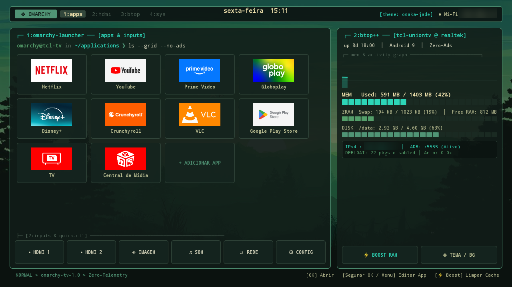
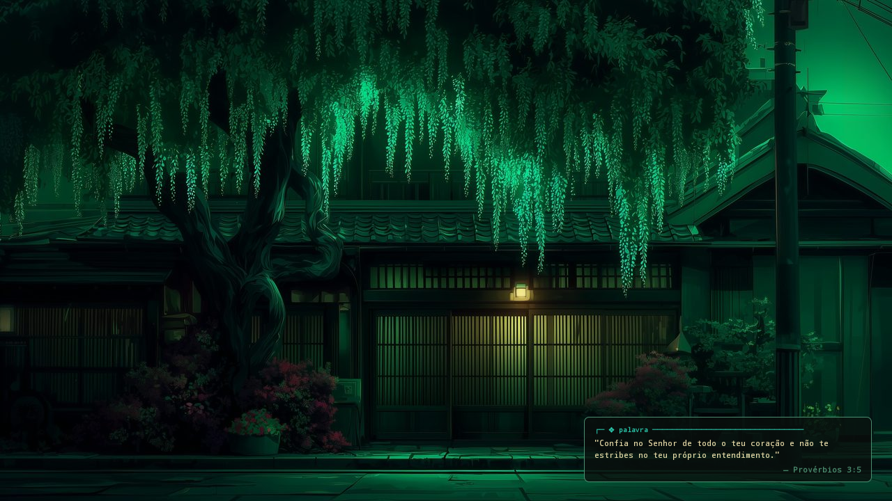
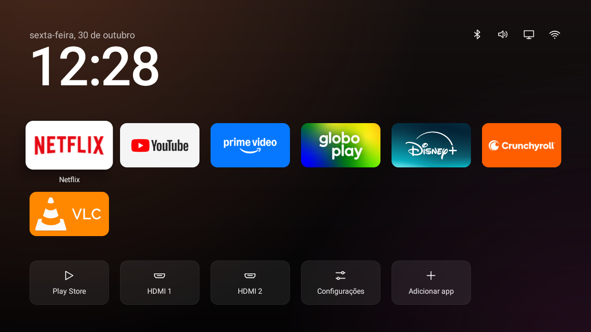

# ❖ Omarchy TV Launcher ("Osaka Jade") & TCL Android TV Debloat

Launcher nativo minimalista em estilo **Tiling Window Manager / Terminal (`Omarchy - Osaka Jade`)** desenvolvido sob medida para Smart TVs **Semp TCL (Android TV)**, acompanhado de scripts de otimização profunda de memória RAM, remoção de telemetria e eliminação total de anúncios na interface.

---

## 📸 Screenshots (Direto da TV Semp TCL)

### 1. Tela Inicial — Estilo Omarchy ("Osaka Jade")


### 2. Modo Ambiente após 40s de Inatividade + Pop-up de Versículo Bíblico


### 3. Comparativo: Antes da Customização


---

## 🚀 O que foi feito neste projeto

### 1. Conexão ADB via Wi-Fi & Diagnóstico do Sistema
- Conexão estabelecida via rede local (`<TV_IP>:5555`) na Smart TV **Semp TCL (`UnionTV`, Android 9)** com `1403 MB` de RAM total e `1023 MB` de ZRAM/Swap.
- Antes da otimização, a TV consumia mais de **72% da RAM (`1010 MB`)** apenas parada na tela inicial devido a serviços residentes da TCL, recomendações patrocinadas e processos em segundo plano.

### 2. Debloat Profundo & Remoção Total de Anúncios e Telemetria (`optimize-tv.sh`)
Foram desativados **22 pacotes de sistema** desnecessários, invasivos ou responsáveis por propagandas e coleta de dados:
- **Telemetria, Anúncios e Bloatware TCL:**
  - `com.tcl.bi` *(serviço de telemetria ativa da TCL)*
  - `com.tcl.tvweishi` *(guardião/limpador proprietário pesado)*
  - `com.tcl.appmarket2` *(loja paralela de aplicativos TCL)*
  - `com.tcl.usercenter` *(conta/login TCL em segundo plano)*
  - `com.tcl.partnercustomizer.resource` *(customizações promocionais)*
  - `com.tcl.useragreement` *(termos e coleta de dados)*
  - `com.tcl.versionUpdateApp` & `com.tcl.copydatatotv`
- **Banners Patrocinados, Recomendações e Bloatware Google:**
  - `com.google.android.leanbacklauncher`
  - `com.google.android.leanbacklauncher.recommendations`
  - `com.google.android.leanbacklauncher.partnerwidget`
  - `com.google.android.leanbacklauncher.partnercustomizer`
  - `com.google.android.tungsten.setupwraith`
  - `com.google.android.tv.bugreportsender`
- **Serviços Inúteis em Smart TVs:**
  - `com.google.android.music`, `com.google.android.syncadapters.contacts`, `com.google.android.syncadapters.calendar`, `com.android.providers.calendar`, `com.android.providers.contacts`, `com.android.providers.userdictionary`, `com.android.wallpaper.livepicker`, `com.android.dreams.basic`.

### 3. Otimização de Desempenho (RAM, CPU e Armazenamento Flash)
- **Limite de Processos em Cache (`max_cached_processes=4`):** Configurado via `activity_manager_constants` para evitar que aplicativos fechados saturem os `1.4 GB` de RAM da TV.
- **Bloqueio de Execução em Background (`RUN_IN_BACKGROUND ignore`):** Aplicado aos principais apps de streaming (`Netflix`, `YouTube`, `Prime Video`, `Disney+`, `Globoplay`, `Crunchyroll`) para que não rodem serviços ocultos quando você não estiver assistindo.
- **Zero Atraso Visual (`0.0x`):** Escalas de animação de janela (`window_animation_scale`), transição (`transition_animation_scale`) e animador (`animator_duration_scale`) definidas em `0`, além da desativação de varredura contínua de Wi-Fi/BLE em background.
- **TRIM na Memória Flash (`sm fstrim`):** Executado na partição `/data` e agendado diariamente.
- **Resultado Prático:** O consumo de RAM em repouso caiu de **`1010 MB` (72%)** para **`~576 MB` (41%)**, liberando mais de **`820 MB` de RAM livre** para reprodução fluida de vídeo.

---

## 🖥️ Arquitetura do Omarchy TV Launcher (`org.omarchy.tvhome`)

Construído em Java puro para Android (`minSdkVersion 21`, `targetSdkVersion 34`) sem dependências pesadas (APK final com apenas **353 KB**!), reproduzindo fielmente o visual do **Omarchy Desktop (tema Osaka Jade)**:

### Paleta de Cores (Osaka Jade)
| Elemento | Cor Hex | Descrição |
| :--- | :--- | :--- |
| `COL_BG_DARKER` | `#090F0D` | Fundo profundo estilo terminal |
| `COL_BG_PANEL` | `#111C18` | Janelas Tiling com transparência |
| `COL_BG_FOCUS` | `#23372B` | Destaque de card focado pelo controle |
| `COL_ACCENT` | `#509475` | Verde Jade principal das bordas |
| `COL_CYAN` | `#2DD5B7` | Ciano vibrante para foco ativo e gráficos |
| `COL_FG` / `COL_FG_BRIGHT` | `#C1C497` / `#F7E8B2` | Tipografia monoespaçada |

### Funcionalidades Principais
1. **Waybar Superior (`buildTopBar`):**
   - Badge `❖ OMARCHY`, indicadores de workspaces (`1:apps`, `2:hdmi`, `3:btop`, `4:sys`), relógio centralizado e indicador de rede Wi-Fi com endereço IPv4 em tempo real.
2. **Janela Tiling Esquerda (`1:omarchy-launcher`):**
   - Prompt de terminal `omarchy@tcl-tv in ~/applications ❯ ls --grid --no-ads`.
   - Grid de aplicativos com navegação rápida por D-Pad. Segure **OK** (ou pressione **Menu**) em qualquer app para **mover**, **substituir**, **remover da tela inicial** ou abrir **informações/forçar parada**.
   - **Barra de Entradas & Controle Rápido (`2:inputs & quick-ctl`):** Acesso direto com 1 clique ao **HDMI 1**, **HDMI 2**, overlays nativos de **Imagem/Brilho** e **Som** da TCL (`com.tcl.settings.SHOW_WINDOW`), **Rede Wi-Fi** e **Configurações**.
3. **Janela Tiling Direita (`2:btop++`):**
   - Monitoramento em tempo real de **Uptime**, gráfico histórico de memória (**Sparkline**), barras segmentadas de **MEM (RAM)**, **ZRAM (Swap)** e **DISK (`/data`)**.
   - Botão **`⚡ BOOST RAM`**: Finaliza processos em background instantaneamente pelo controle remoto e exibe um Toast com o total de MB liberados.
   - Botão **`❖ TEMA / BG`**: Permite alternar entre os 3 papéis de parede oficiais do **Omarchy Osaka Jade** (*Glowing City*, *Shaded Entrance*, *Mountain Moon*) ou o fundo sólido **Pure Terminal (`#090f0d`)**.
4. **Modo Ambiente após 40s de Inatividade + Versículo Bíblico (`enterAmbientMode`):**
   - Após **40 segundos** sem interação no controle remoto, todos os cards e o escurecimento de fundo entram em transição suave de `3.5s` (interpolação cúbica própria em 60fps que funciona mesmo com `animator_duration_scale=0`) até ficarem 100% transparentes, deixando apenas a arte do papel de parede **Osaka Jade** na tela.
   - No **canto inferior direito**, surge um pequeno pop-up estilizado (`┌─ ❖ palavra`) com um **versículo bíblico curto aleatório**, alternando automaticamente a cada 20 segundos com efeito *crossfade*.
   - Ao pressionar qualquer tecla no controle remoto, a interface desperta imediatamente em `220ms` sem disparar cliques acidentais.

---

## 🛠️ Estrutura do Repositório & Como Compilar / Instalar

```text
.
├── app/src/main/
│   ├── AndroidManifest.xml
│   ├── assets/                        # Papéis de parede Osaka Jade otimizados (bg1, bg2, bg3)
│   └── java/org/omarchy/tvhome/
│       └── MainActivity.java          # Código-fonte completo do Launcher + btop++ + Modo Ambiente
├── docs/screenshots/                  # Capturas de tela reais da TV Semp TCL
├── build.sh                           # Script de compilação standalone (aapt2 + javac + d8 + apksigner)
├── optimize-tv.sh                     # Script de Debloat, otimização de RAM e deploy via ADB Wi-Fi
└── omarchy-tv-launcher.apk            # APK assinado pronto para instalação (353 KB)
```

### Instalação Rápida na TV via ADB Wi-Fi
```bash
chmod +x optimize-tv.sh
./optimize-tv.sh <TV_IP>:5555
```
